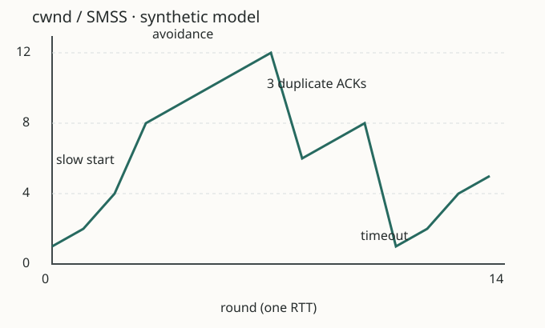

# 14주차 · 지연·윈도·분산의 핵심 원리

요약: 요청 전체 시간과 망의 지연 성분을 구별하고 단위·가정을 붙여 병목·BDP·윈도 상한을 계산한다. 고전 혼잡 그래프와 상태 확인의 한계를 읽고 실제 서버 제외·복구를 판단할 관찰을 고른다.

[개인 공부 정리](README.md#personal-notes)에서는 이 교재의 핵심·혼동 구별을 주요 질문과 내 답에 연결한다. 먼저 설명하고 해설과 비교한 뒤, 확인한 근거와 고친 이해를 기존 개인 노트에 보완한다.

## 먼저 연결할 개념

[4주차](../week-04/CONCEPTS.md)의 rwnd는 받는 쪽 버퍼를 지키고 cwnd는 망 혼잡에 맞춰 보내는 양을 제한한다. [8주차](../week-08/CONCEPTS.md)의 파이프라이닝은 ACK를 기다리는 동안 여러 데이터를 보낼 수 있게 한다. [13주차](../week-13/CONCEPTS.md)는 요청을 보낸 위치와 받은 서버 로그를 나누어 본다. 이번에는 그 조건이 속도에 미치는 영향을 계산한다.

<span id="delay"></span>

## W14-K1 · 전체 대기 시간을 망 지연 하나로 설명하지 않는다

**기억 문장:** 패킷의 처리·큐잉·전송·전파와 애플리케이션 처리는 서로 다른 비용이다.

| 성분 | 뜻·바뀌는 조건 | 작은 예 |
| --- | --- | --- |
| 처리 processing | 헤더 검사 등 노드가 패킷을 처리하는 시간 | 주어진 노드 처리 0.1ms |
| 큐잉 queueing | 앞선 패킷 때문에 송신 대기열에서 기다리는 시간 | 부하에 따라 달라짐·문제에서는 0.4ms 고정 |
| 전송 transmission | L bit를 속도 R bit/s 링크로 밀어 넣는 시간 L/R | 12,000bit / 10,000,000bit/s = 1.2ms |
| 전파 propagation | 신호가 링크 길이를 이동하는 시간 거리/전파속도 | 200km / 200,000km/s = 1ms |

패킷 하나가 한 링크를 지나 수신 끝에 도착할 때 위 비용을 주어진 경계에서 더할 수 있다. 여러 링크라면 저장 후 전달(store-and-forward), 헤더·전송 시작 위치·노드 수를 명시해야 한다. L은 이 모형에서 링크로 내보낼 전체 bit 수다. HTTP 본문 byte 수만 넣고 헤더까지 포함했다고 말하지 않는다.

```text
노드 처리 → 큐에서 대기 → L bit를 내보냄 → 신호가 이동 → 수신 끝
클라이언트 요청 전체: 이름/TCP/TLS/요청 전송/서버 대기/응답 수신도 포함 가능
```

### 계산 묶음 A · 지연과 병목

자체 문제다. 하나의 1,500byte 패킷을 두 링크에 저장 후 전달한다. 링크 R1=10Mbps, R2=100Mbps, 각 길이 200km, 전파속도 200,000km/s다. 처리 0.1ms·큐잉 0.4ms를 **출발 노드와 중간 라우터에서 각각 한 번** 더한다. 목적지 추가 처리는 제외한다. 헤더·오버헤드는 L=1,500byte에 이미 포함했다고 가정한다.

1. 두 전송 지연과 두 전파 지연을 구하고, 첫 bit를 처리하기 시작한 때부터 마지막 bit가 목적지에 도착할 때까지 합한다.
2. R2만 1Gbps로 바꾸면 긴 패킷열의 이상적 병목 속도는 어떻게 되는가? 첫 패킷의 지연도 같은 비율로 줄어드는가?

풀이 전에는 [해설 Q1\~Q2](ANSWERS.md)를 가린다. 병목 처리량은 직렬 경로에서 가장 작은 사용 가능 전송률에 제한된다. 여러 패킷이 파이프라인을 채운 뒤의 전송률과 첫 패킷의 두 전송 지연 합을 혼용하지 않는다. 공유 부하·손실·프로토콜 비용을 뺀 단순 상한이며 애플리케이션 goodput 보장이 아니다. 공식 연결: [Kurose·Ross 자체 계산 도구](SOURCES.md).

<span id="window"></span>

## W14-K2 · 윈도는 ACK 전에 떠 있을 수 있는 데이터의 양을 제한한다

**기억 문장:** 유효 전송 윈도는 cwnd와 rwnd의 작은 쪽이고, W/RTT는 가정 아래의 속도 상한이다.

BDP(bandwidth-delay product)는 대역폭과 왕복 시간의 곱이다. `100Mbps × 0.1s = 10Mbit = 1.25MB`다. 이 왕복 동안 링크를 계속 채우려면 그 정도의 미확인 데이터가 떠 있을 수 있어야 한다는 크기 척도다. 모든 버퍼에 이 크기를 반드시 할당하라는 규칙은 아니다. 여기서 M=10⁶, 1byte=8bit이며 MB와 MiB를 섞지 않는다.

```text
W = min(cwnd, rwnd)          [byte]
추가로 보낼 수 있는 양 ≈ max(0, W − 아직 ACK되지 않은 데이터) [byte]
이상적 전송률 상한 = min(병목 bit/s, W × 8 / RTT초)
```

계산에서는 충분한 송신 데이터·고정 RTT/윈도·긴 전송·빠른 ACK/처리를 가정한다. 초기 혼잡 윈도 증가·손실·재전송·헤더·앱 대기·다른 병목은 생략한다. 관찰한 짧은 HTTP 한 번의 `time_total`을 RTT에 넣어 TCP 처리량을 예측하지 않는다. ACK는 앱의 성공 처리를 보장하지 않는다.

### 계산 묶음 B · 윈도와 조건 변경

100Mbps 링크, RTT=100ms, cwnd=80,000byte, rwnd=200,000byte의 자체 모형이다.

1. BDP·W·W/RTT 상한을 계산한다. 아직 ACK되지 않은 데이터가 30,000byte이면 추가 송신 여유는 얼마인가?
2. rwnd만 40,000byte로 줄이면 상한은 어떻게 되는가? 그 뒤 RTT만 50ms로 줄이면? 이 계산이 실제 HTTP 속도의 보장인지 설명한다.

### 제공 그래프 · 고전 혼잡 제어 읽기

아래 SVG와 [수치 원본](../../labs/week-14/congestion.txt)은 **자체 교육 모형**이다. 특정 OS의 TCP 캡처가 아니다. x축은 일정한 RTT 한 번을 한 라운드로 센 관측점, y축은 cwnd/SMSS다. ACK마다 갱신되는 실제 궤적·일시적 fast recovery 팽창은 생략하고 안정된 라운드 경계만 잇는다. 충분한 송신 데이터·rwnd≥32SMSS·손실 전 FlightSize=cwnd·초기 cwnd=1SMSS·ssthresh=8SMSS를 가정한다. 초기값 1은 그림용이며 모든 현재 TCP의 시작값이 아니다.

<div class="table-scroll" tabindex="0" role="region" aria-label="혼잡 그래프 · 가로로 이동해 전체 보기"></div>

화면이 좁으면 그래프 안을 가로로 이동한다. 축과 라벨은 원래 크기로 읽는다.

| 관측점 | cwnd/SMSS | 해석 |
| --- | --- | --- |
| 0\~3 | 1, 2, 4, 8 | 새 데이터를 ACK하는 응답이 충분히 오면 slow start에서 라운드별 빠른 증가 |
| 3\~7 | 8, 9, 10, 11, 12 | 이 그림은 문턱에 도달하면 혼잡 회피를 택함. 대략 RTT당 1SMSS 증가 |
| 7→8 | 12→6 | 세 중복 ACK로 손실을 추정해 fast retransmit/recovery. 복구가 끝난 경계에서 FlightSize 절반 수준으로 낮춘 단순화 |
| 8\~10 | 6, 7, 8 | 혼잡 회피로 다시 증가 |
| 10\~14 | 8→1→2→4→5 | 타임아웃 뒤 1로 낮추고 새 문턱 4까지 slow start, 이후 혼잡 회피 |

빠른 증가가 항상 처리량 증가를 보장하지 않는다. rwnd가 4SMSS라면 큰 cwnd라도 실제 미확인 데이터는 수신 윈도로 제한된다. 중복 ACK는 재정렬에서도 생길 수 있어 손실의 완벽한 증거가 아니다. 현대 CUBIC/BBR 등 모든 알고리즘을 이 그림으로 일반화하지 않는다. [RFC5681 §2·§3.1·§3.2](SOURCES.md)는 용어·고전 동작의 근거이며 특정 Linux 설정의 증거가 아니다.

<span id="proxy"></span>

## W14-K3 · 백엔드 제외와 서비스 회복을 함께 확인한다

**기억 문장:** 서버 목록·상태 확인·실제 요청 결과는 각각 봐야 한다.

```text
같은 Linux 호스트
curl → 127.0.0.1:18080 프록시 → a:18081 / b:18082
                              각 서버는 /health와 /echo 제공
enabled.txt: 사용할 서버 목록      /status: 현재 조회 결과
```

프록시는 클라이언트 요청을 받아 백엔드(뒤에서 처리하는 서버)에 별도 HTTP 요청을 보낸다. 이 키트는 매 요청마다 두 `/health`를 순서대로 확인하고, 설정에 포함되면서 200·올바른 식별자를 보인 서버만 round robin으로 선택한다. 후보가 안정적이고 요청이 순차라면 a,b를 번갈아 고른다. 실제 전달이 실패하면 502를 반환하고 자동 재시도하지 않는다. 후보가 없으면 503이다. `/status`의 HTTP200은 조회가 됐다는 뜻이며 서비스가 정상이라는 뜻은 아니다.

상태 확인에는 지연을 넣지 않으므로 `/health=200`이어도 `/echo`는 0.2초 기다릴 수 있다. 또한 상태 확인 직후 서버가 멈출 수 있다. 따라서 X-Backend·HTTP 상태·응답 본문·클라이언트 시간·로그를 함께 본다. 관리상 b를 제외해도 b가 죽은 것은 아니다. 제외 후 오류가 없어도 한 서버가 남은 부하를 감당하는지 별도로 확인해야 한다. 이번 5회 순차 시험은 용량·고가용성·백분위 지연의 증명이 아니다.

매 요청의 상태 조회·신규 연결·스케줄링 비용은 프록시 전체 시간에 포함된다. 이 구현의 비용을 일반적인 운영 LB 비용으로 쓰지 않는다. 같은 호스트의 두 포트는 프로세스 전환만 보며 호스트·전원·물리 링크 장애는 공통으로 영향을 받는다. 운영 제품의 주기적 점검/실패 문턱·긴급 재시도 정책은 선택 후속이다.

## 헷갈리는 구별 두 가지

| 잘못 섞은 설명 | 조건을 붙여 고친 설명 |
| --- | --- |
| TTFB가 200ms 늘었으니 망 RTT가 200ms 늘었다 | 첫 응답 byte까지는 앱 처리·연결·전송 대기가 포함된다. 같은 요청과 서버 처리 로그·연결 시간을 함께 대조한다 |
| cwnd는 수신 버퍼이고, 백엔드 health가200이면 사용자는 정상이다 | rwnd는 수신 측 한도·cwnd는 송신 측 혼잡 한도다. 상태 확인 경로와 실제 요청 경로의 결과도 다를 수 있다 |

<span id="operational-bridge"></span>

## 앞 개념으로 운영 증상을 읽기

### 평균이 같아도 느린 요청은 달라질 수 있다

다음은 실측이 아닌 **각 100개 요청으로 만든 두 가공 분포**다. 모든 요청은 HTTP200이며 시간 단위는 ms다. p95에는 p=0.95, p99에는 p=0.99를 넣어 오름차순으로 정렬한 값 중 `ceil(p×100)`번째를 고르는 nearest-rank 방식으로 계산한다. 실제 관측 시스템은 백분위 추정 방법이 다를 수 있다.

| 분포 | 요청시간의 구성 | 평균 | p95 | p99 |
| --- | --- | --- | --- | --- |
| A | 100개 모두 69ms | 69ms | 69ms | 69ms |
| B | 95개는 20ms, 5개는 1,000ms | 69ms | 20ms | 1,000ms |

B의 합은 `95×20+5×1,000=6,900ms`다. 평균은 같아도 느린 5개 요청의 경험은 다르다. HTTP 오류0이어도 지연 기준을 넘긴 요청이 있을 수 있다. 백분위 하나만으로 원인을 확정하지 않고 요청량·실패/timeout·서버 자원/대기열의 여유를 함께 본다. **포화**는 CPU·처리 슬롯·큐 등 제한된 자원이 감당할 수 있는 수준에 얼마나 가까운지 보는 관점이다.

이 표는 분포를 읽는 계산 예이며 실제 서비스의 p99를 추정한 결과가 아니다. 앞의 5회 순차 실험과도 다른 자료다. 실서비스 판단에는 관측 기간·요청 조건·표본 수·실패 처리·측정 방법을 정해야 한다. [Google SRE의 Four Golden Signals](https://sre.google/sre-book/monitoring-distributed-systems/)에서 성공/실패 지연·트래픽·오류·포화를 연결해 읽는다.

### 기존 연결은 되는데 새 연결만 실패한다면

6주의 지속 연결은 연결 수립을 생략하고 11주의 상태 기반 규칙은 기존/새 연결에 다르게 적용될 수 있다. 같은 서버에서도 기존 연결의 GET은200, 새 TCP 연결은 timeout인 관찰이 가능하다. 이 증상만으로 서버 전체 중지나 자원 고갈을 확정하지 않는다.

연결 풀은 다시 쓸 연결을 모아 관리하는 방식이다. 파일 디스크립터(FD)는 운영체제가 열린 파일·소켓 등을 구별하는 번호이며 프로세스별 사용 한도가 있다. 연결 수·임시 포트·접속 대기열 등의 한계도 새 연결의 진행에 영향을 줄 수 있다. 각 한계는 관찰해야 할 별도 가설이며 모두 TCP 윈도와 같은 자원이 아니다. Linux의 정의와 실패 조건은 [getrlimit의 RLIMIT_NOFILE](https://man7.org/linux/man-pages/man2/getrlimit.2.html), [listen의 backlog/NOTES](https://man7.org/linux/man-pages/man2/listen.2.html), [connect의 ERRORS](https://man7.org/linux/man-pages/man2/connect.2.html)에서 필요한 부분만 참조한다.

| 가설 | 구별할 다음 관찰 |
| --- | --- |
| 새 연결에 적용되는 정책·출발지 조건이 다름 | 같은 출발지/대상의 기존·새 연결 비교, 규칙/상태·카운터와 양끝 패킷 |
| 서버/클라이언트의 연결 자원이 부족함 | 같은 시점의 리스너·연결 상태 수, 프로세스 자원 사용/한도와 accept/connect 오류 로그 |

한 관찰은 다른 원인을 모두 배제하지 않는다. 설정을 바꾸기 전에 어느 가설에서 예상이 달라지는지 설명한다. [Google SRE 과부하 설명](https://sre.google/sre-book/handling-overload/)과 연결하되 제공 사례 분석까지만 하고 자원 고갈·임의 한도 변경은 수행하지 않는다.

**오프라인 연결 질문:** 두 분포의 평균만 보고 같다고 판단하면 무엇을 놓칠까? 기존/새 연결 증상을 나눌 관찰 하나를 고르고 6·11주 원리로 이유를 설명한다. [분리 해설](ANSWERS.md#operational-bridge)은 시도 뒤에 읽는다.

## 개발 상황과 다음 복습

[W14-D1\~D3](WORKSHEET.md)를 이번 서버 대기·제외 실험에 연결하고 [분리 해설](ANSWERS.md#development)을 대조한다. 다음 주에는 “점검 스크립트가 health만 기록하면 무엇을 놓칠까?”를 기존 복습 시간에 다시 묻는다. [전체 개념 색인](../CONCEPT_INDEX.md) · [실습·코드 읽기](LINUX.md) · [출처](SOURCES.md).
